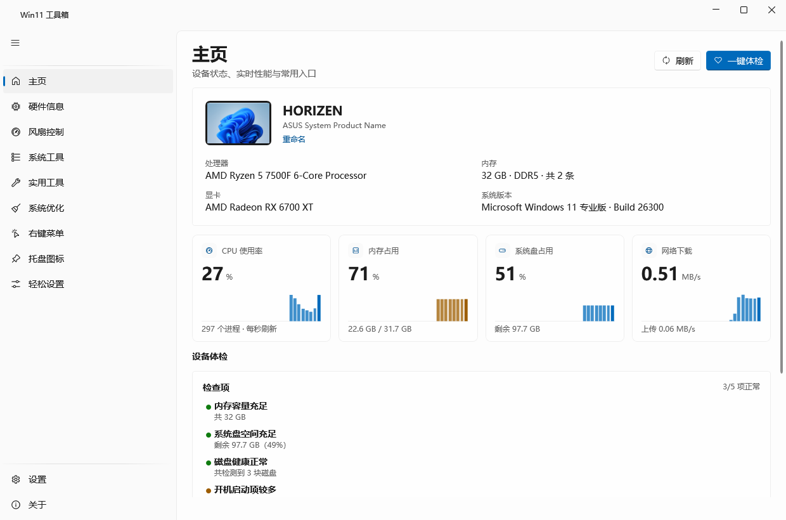
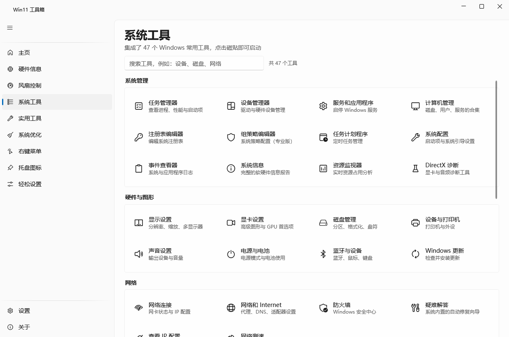
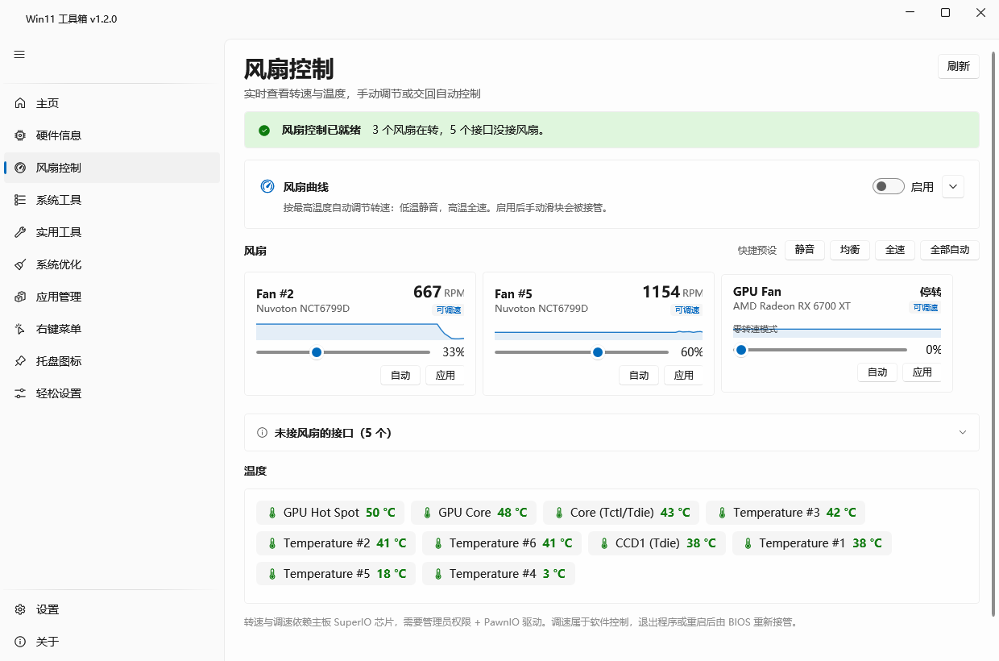
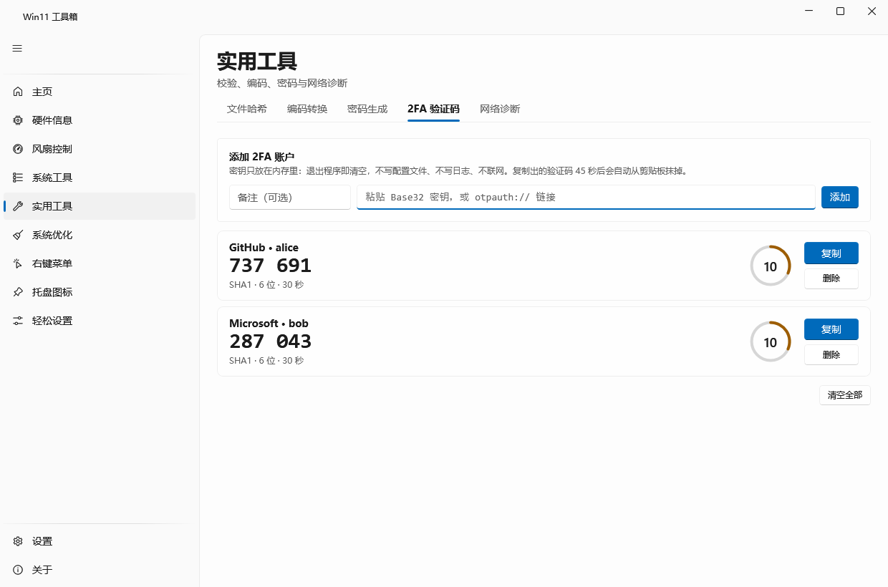
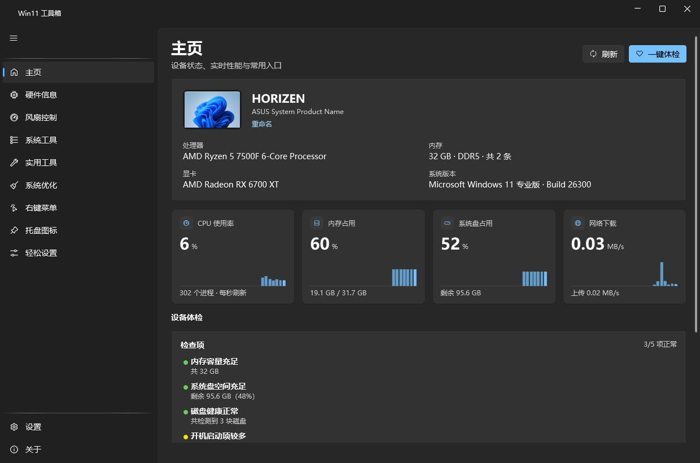

<h1 align="center">Win11 工具箱</h1>

<p align="center"><strong>把 Windows 11 散落在十几个地方的设置、硬件信息和维护工具，收进一个窗口。</strong></p>

<p align="center">
  
  
  
  
</p>

<p align="center">
  <a href="#功能">功能</a> ·
  <a href="#截图">截图</a> ·
  <a href="#下载">下载</a> ·
  <a href="#从源码构建">从源码构建</a> ·
  <a href="#常见问题">常见问题</a>
</p>

<p align="center">
  
</p>

---

## 这是什么

Windows 11 的设置项散在十几个地方：想显示文件扩展名要翻三层菜单，想看内存插槽得开任务管理器，
想知道风扇转速只能进 BIOS。改个右键菜单要装第三方工具，清理临时文件要再装一个。

这个工具把这些收进一个窗口：**十个页面，47 个系统工具，124 项右键菜单，40 个系统开关**，
界面用 Win11 自己的 Fluent 设计语言和 Mica 云母背景，不是套壳的网页，也不是 WinForms 换皮。

## 功能

| 页面 | 做什么 |
| --- | --- |
| **主页** | 设备卡（版式同「设置 → 系统」：设备图 + 名称 + 型号 + 重命名）、CPU / 内存 / 系统盘 / 网络的**秒级柱状历史**、一键体检、8 个常用入口 |
| **硬件信息** | 8 个选项卡：概览 / 处理器 / 内存（**逐条插槽**）/ 显卡 / 主板与固件 / 存储 / 网络 / 其他 |
| **风扇控制** | 温度→转速曲线 + 手动调速 + 实时转速温度，思路参考 [Fan Control](https://github.com/Rem0o/FanControl.Releases)；主板侧驱动随程序分发，一键安装 |
| **系统工具** | 47 个 Windows 内置工具的分类磁贴，用 **Segoe Fluent Icons**（与系统设置同源的字形）+ 关键词搜索 |
| **实用工具** | 文件哈希、Base64 / URL 编解码、随机密码、**2FA 验证码**（TOTP，密钥不落盘）、端口检测、Ping |
| **系统优化** | 临时文件扫描清理、回收站、DNS 缓存、图标缓存、资源管理器重启、`sfc`、启动项列表（带软件图标，同任务管理器） |
| **右键菜单** | 124 项右键菜单扫描（含 12 项文件右键菜单），勾选后**备份再禁用**、随时恢复、可导出记录 |
| **托盘图标** | 36 项「其他系统托盘图标」清单，固定到任务栏 / 收进溢出区，支持撤销 |
| **轻松设置** | 40 项安全系统开关（扩展名、隐藏文件、经典右键菜单等），带「需管理员 / 需重启」角标；底部电源计划一键切换 |
| **设置 / 关于** | 深色模式与跟随系统、版本信息 |

几个值得一提的细节：

- **所有开关都是「可逆」的。** 右键菜单禁用前先把整个注册表键导出成 `.reg` 备份到本地，
  恢复就是把备份导回去；托盘图标改动记在 `disabled.tsv` 里，随时撤销。
- **2FA 密钥只在内存。** 不写配置文件、不写日志、不联网，退出程序即清空，
  复制出的验证码 45 秒后自动从剪贴板抹掉。
- **监控采样不在 UI 线程。** 每秒的进程枚举、网卡统计放在线程池里跑，界面只负责最后塞数字，
  滚动和切换页面不会被拖住。

## 截图

<p align="center">
  
  
  <br>
  <sub>左：系统工具 · 47 个内置工具，按用途分类　　右：风扇控制 · 温度曲线与手动调速</sub>
</p>

<p align="center">
  
  
  <br>
  <sub>左：实用工具 · 2FA 验证码与倒计时　　右：深色模式 · 跟随系统主题</sub>
</p>

## 下载

到 [Releases](https://github.com/Horizen5/Win11Toolbox/releases) 下载：

| 版本 | 大小 | 需要装 .NET 吗 | 适用 |
| --- | --- | --- | --- |
| `Win11工具箱.exe`（单文件） | ~69 MB | 不需要 | 直接双击，最省事 |
| `Win11Toolbox-lite.exe` | ~16 MB | 需要 .NET 10 桌面运行时 | 已经装了运行时，想省空间 |

绿色程序，不写注册表、不装服务，删掉 exe 就是卸载（配置在 `%APPDATA%\Win11Toolbox\`，可一并删除）。

## 从源码构建

需要 **.NET 10 SDK**：

```bash
git clone https://github.com/Horizen5/Win11Toolbox.git
cd Win11Toolbox
dotnet build -c Release
dotnet run -c Release
```

打包成单文件：

```bash
dotnet publish -c Release -r win-x64 --self-contained true -o publish
```

> 构建产物体积会到 69 MB，因为把 .NET 运行时一起压进去了。这是"单文件免安装"的代价。

## 技术栈

| | |
| --- | --- |
| 语言 / 框架 | C# 13 · .NET 10 · WPF |
| 界面 | [WPF-UI 4.3](https://github.com/lepoco/wpfui)（Fluent 控件 + Mica 背景） |
| 硬件 | [LibreHardwareMonitorLib 0.9.6](https://github.com/LibreHardwareMonitor/LibreHardwareMonitor) + WMI |
| 系统接口 | P/Invoke（`SHSetKnownFolderPath`、`ADL2`、`DwmFlush` 等） |
| 分发 | 单文件自包含，无外部依赖 |

### 为什么不用 WinUI 3

一开始就是按 WinUI 3（Windows App SDK）搭的，`dotnet build` 直接卡在：

```
error MSB4062: 未能从程序集 ...\AppxPackage\Microsoft.Build.Packaging.Pri.Tasks.dll 加载任务 ExpandPriContent
error MSB4062: ... 加载任务 RemovePayloadDuplicates
```

这两个任务（资源索引 PRI、Appx 打包）只随 Visual Studio 的 MSBuild 提供，纯 .NET SDK 里没有；
关掉 `AppxGeneratePriEnabled` 过了一个还会卡在下一个。要么装 5 GB 的 VS Build Tools，
要么换框架。

换成 WPF + WPF-UI 之后 `dotnet build` 干净通过，同时保住了原生 Mica、系统主题色、
`Segoe UI Variable` 字体和 Win11 的控件外观。唯一的差别是控件由 WPF-UI 复刻而非系统 WinUI 提供。

更多技术细节、以及一堆"看起来像 bug 其实是系统行为"的排查记录，见
[docs/NOTES.md](docs/NOTES.md)。

## 常见问题

**需要管理员权限吗？**

大部分功能不需要。只有这些会弹 UAC：修改 `HKLM` 下的右键菜单项、运行 `sfc`、安装风扇驱动。
程序会在需要时单独提权，不是整个程序以管理员身份运行。

**会收集数据 / 联网吗？**

不会。全部功能在本机完成，没有遥测、没有联网请求。唯一的网络访问是你主动点的 Ping 和端口检测。

**为什么杀毒软件会报警？**

两个原因：一是风扇控制需要装内核驱动（PawnIO，开源），二是右键菜单管理会读写注册表。
源码全在这里，可以自己编译验证。

**支持 Windows 10 吗？**

没有测试过。界面大量依赖 Win11 的 Fluent 设计令牌和 Mica 背景，在 Win10 上会退化成普通 WPF 外观，
功能是否正常不保证。

**风扇控制提示"未检测到主板风扇"？**

需要先装 PawnIO 驱动。程序内置了安装包，点页面上的「安装驱动」即可，装完自动刷新。

**2FA 密钥存在哪？**

不存。只在内存里，退出即清空。所以每次启动都要重新粘贴——这是刻意的。

## 致谢

- [WPF-UI](https://github.com/lepoco/wpfui) —— Fluent 控件与主题资源
- [LibreHardwareMonitor](https://github.com/LibreHardwareMonitor/LibreHardwareMonitor) —— 硬件传感器读取
- [PawnIO](https://github.com/namazso/PawnIO) —— 内核驱动，让用户态能读写 SuperIO
- [Fan Control](https://github.com/Rem0o/FanControl.Releases) —— 风扇曲线的交互参考

## 许可

[MIT](LICENSE)

`tools/PawnIO_setup.exe` 是 [PawnIO](https://github.com/namazso/PawnIO) 的官方安装包（MIT），
随程序分发以便一键安装驱动。
