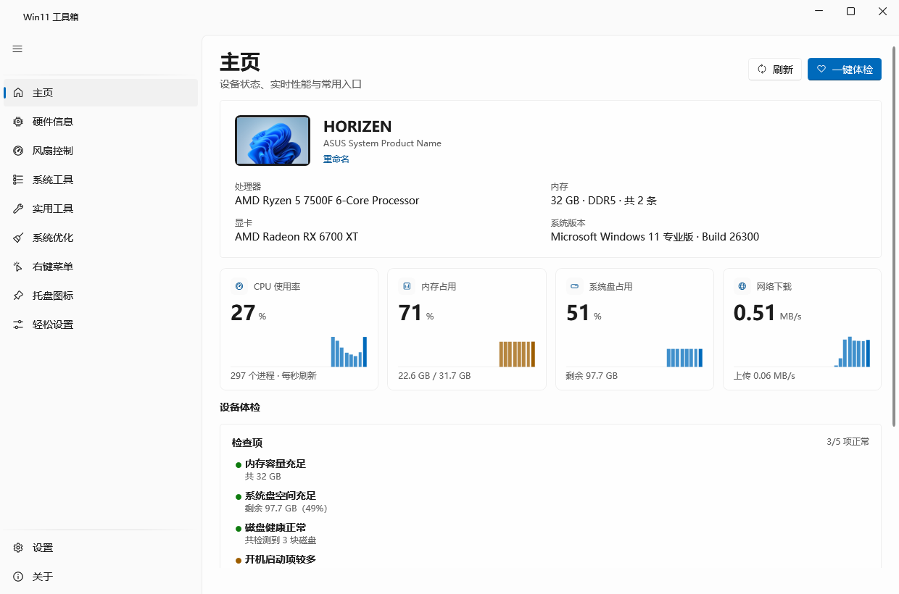
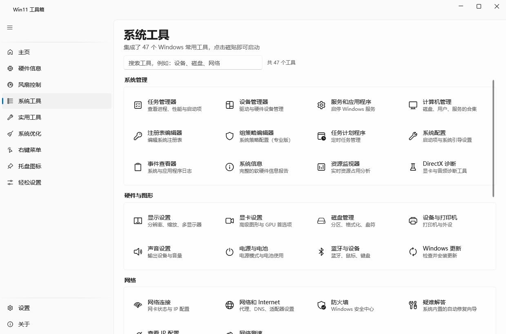
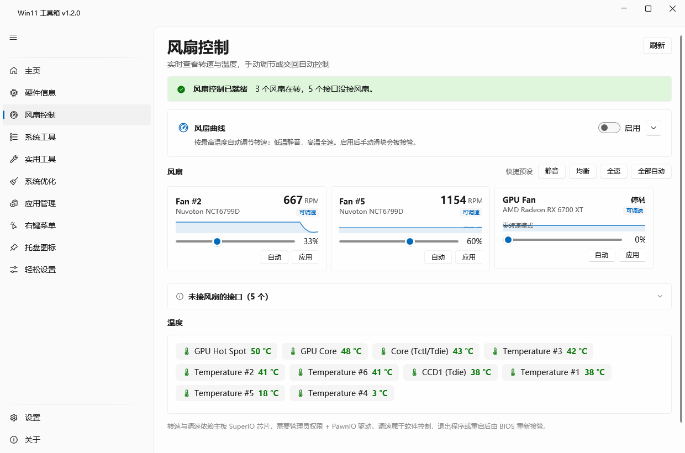
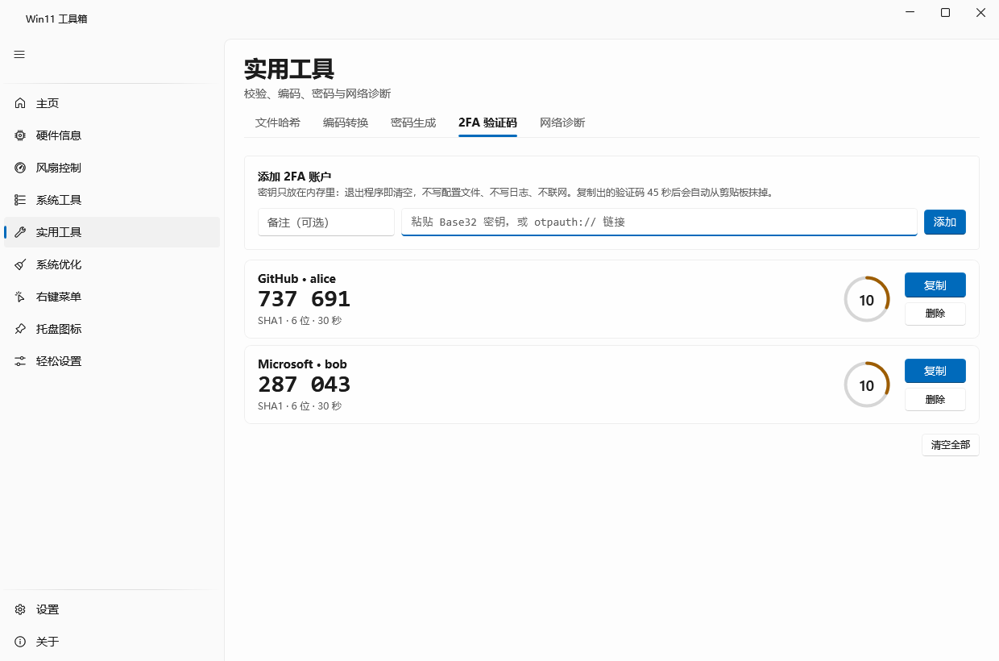
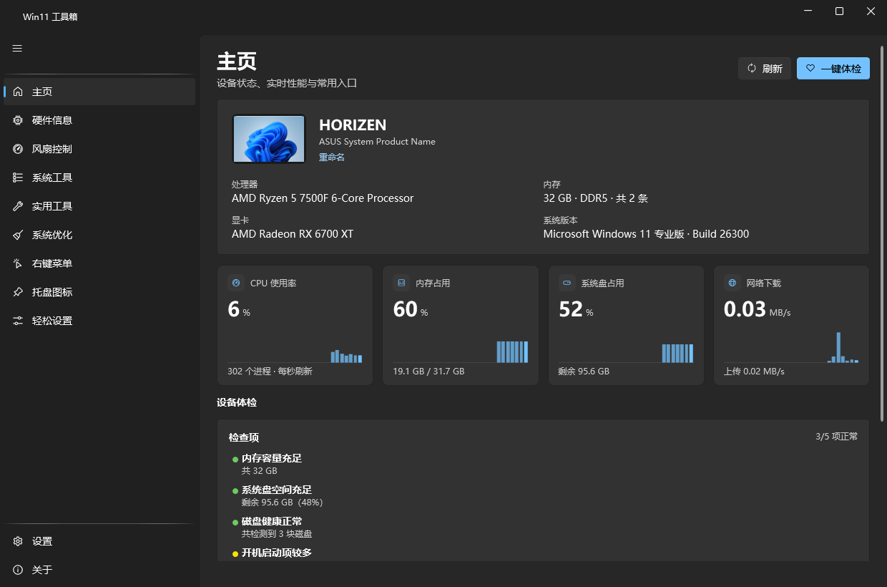

<h1 align="center">Win11 工具箱</h1>

<p align="center"><strong>把 Windows 11 散落在十几个地方的设置、硬件信息和维护工具，收进一个窗口。</strong></p>

<p align="center">
  
  
  
  
  
</p>

<p align="center">
  <a href="#功能">功能</a> ·
  <a href="#截图">截图</a> ·
  <a href="#下载">下载</a> ·
  <a href="#从源码构建">从源码构建</a> ·
  <a href="#常见问题">常见问题</a>
</p>

<p align="center">
  
</p>

---

## 这是什么

Windows 11 的设置项散在十几个地方：想显示文件扩展名要翻三层菜单，想看内存插槽得开任务管理器，
想知道风扇转速只能进 BIOS。改个右键菜单要装第三方工具，清理临时文件要再装一个。

这个工具把这些收进一个窗口：**十一个页面，47 个系统工具，130 多项右键菜单，65 个系统开关，
58 款常用软件的一键安装清单，10 种界面语言**，界面用 Win11 自己的 Fluent 设计语言和 Mica 云母背景，
不是套壳的网页，也不是 WinForms 换皮。

## 功能

| 页面 | 做什么 |
| --- | --- |
| **主页** | 设备卡（版式同「设置 → 系统」：设备图 + 名称 + 型号 + 重命名）、CPU / 内存 / 系统盘 / 网络的**秒级柱状历史**、一键体检、8 个常用入口 |
| **硬件信息** | 9 个选项卡：概览 / 处理器 / 内存（**逐条插槽**）/ 显卡 / 主板与固件 / **电源电压** / 存储 / 网络 / 其他 |
| **风扇控制** | 温度→转速曲线 + 手动调速 + 实时转速温度（含会话最高温）；思路参考 [Fan Control](https://github.com/Rem0o/FanControl.Releases)；按转速自动区分「接了风扇」和「空接口」，通道可双击改名；主板侧驱动随程序分发，一键安装 |
| **系统工具** | 47 个 Windows 内置工具的分类磁贴，用 **Segoe Fluent Icons**（与系统设置同源的字形）+ 关键词搜索 |
| **实用工具** | 文件哈希、Base64 / URL 编解码、随机密码、**2FA 验证码**（TOTP，密钥不落盘）、端口检测、Ping |
| **系统优化** | 临时文件扫描清理、回收站、DNS 缓存、图标缓存、资源管理器重启、`sfc`、启动项列表（带软件图标，同任务管理器） |
| **应用管理** | **58 款**常用软件的 winget 装机清单（勾选一键装、自动标出已装），已装应用与系统预装包卸载（系统组件只展示不允许卸），一键创建系统还原点 |
| **右键菜单** | 右键菜单扫描，覆盖**文件 / 文件夹 / 文件夹空白处 / 所有文件夹 / 驱动器 / 所有对象 / 桌面空白处 / 回收站 / 此电脑**九个位置，勾选后**备份再禁用**、随时恢复、可导出记录 |
| **托盘图标** | 36 项「其他系统托盘图标」清单，固定到任务栏 / 收进溢出区，支持撤销 |
| **轻松设置** | **65 项**安全系统开关，分 9 类：资源管理器 / 右键菜单 / 任务栏 / 桌面 / 通知 / 开始菜单 / 系统性能 / Windows 更新 / 隐私。带「需管理员 / 需重启」角标；底部电源计划一键切换 |
| **设置 / 关于** | 深色模式与跟随系统、**10 种界面语言即时切换**、版本信息 |

几个值得一提的细节：

- **所有开关都是「可逆」的。** 右键菜单禁用前先把整个注册表键导出成 `.reg` 备份到本地，
  恢复就是把备份导回去；托盘图标改动记在 `disabled.tsv` 里，随时撤销。
- **2FA 密钥只在内存。** 不写配置文件、不写日志、不联网，退出程序即清空，
  复制出的验证码 45 秒后自动从剪贴板抹掉。
- **监控采样不在 UI 线程。** 每秒的进程枚举、网卡统计放在线程池里跑，界面只负责最后塞数字，
  滚动和切换页面不会被拖住。
- **切语言不用重启。** 在设置页选完立刻全窗口生效，词典内嵌在单文件 exe 里；
  想补词条可以放 `%APPDATA%\Win11Toolbox\locales-override.json`，无需重新编译。

## 截图

<p align="center">
  
  
  <br>
  <sub>左：系统工具 · 47 个内置工具，按用途分类　　右：风扇控制 · 三列卡片、转速趋势与温度曲线（截图为 v1.2.x 界面）</sub>
</p>

<p align="center">
  
  
  <br>
  <sub>左：实用工具 · 2FA 验证码与倒计时　　右：深色模式 · 跟随系统主题</sub>
</p>

## 下载

当前版本 **v1.3.1**。到 [Releases](https://github.com/Horizen5/Win11Toolbox/releases) 下载：

| 版本 | 大小 | 需要装 .NET 吗 | 适用 |
| --- | --- | --- | --- |
| `Win11Toolbox.exe`（单文件） | ~69 MB | 不需要 | 直接双击，最省事 |
| `Win11Toolbox-lite.exe` | ~16 MB | 需要 .NET 10 桌面运行时 | 已经装了运行时，想省空间 |

绿色程序，不写注册表、不装服务，删掉 exe 就是卸载（配置在 `%APPDATA%\Win11Toolbox\`，可一并删除）。

## 更新记录

### v1.3.1

- **电源电压挪到「硬件信息 → 电源电压」选项卡**：三张主轨卡片 + 可折叠的其他电压，
  页签可见时每 3 秒刷新，离开页面自动停表；风扇页回归只管风扇与温度。
- **去掉手动倍率校准**：不再让人填数字，系数改成实测校准值（+12V ×11.98、+5V ×5.02、
  +3.3V ×1）。和 HWiNFO 共享内存接口做同源对照，三路差异 **−0.003‰ / 0.000‰ / 0.000‰**。
- 新增 `--voltsample`（零窗口连续采样）与 `--shot --tab N`（指定选项卡离屏截图）两个诊断参数。

### v1.3.0

- **风扇页新增电源电压监测**：+12V / +5V / +3.3V 三路读数还原、板型分压系数、
  万用表倍率校准（持久化、可一键恢复）、每条轨道的 Min/Max / 相对压降，
  以及可折叠的「其他电压」清单。温度卡补上会话最高温与传感器统计。
- **10 种界面语言**：自动跟随系统 / 简体中文 / English / 繁體中文 / 日本語 / 한국어 /
  Español / Français / Deutsch / Русский / Português (Brasil)，设置页切换即时生效。
- **启动 I/O 优化**：硬件信息改为缓存优先，磁盘枚举与回收站扫描移出启动路径，
  解决开机打开软件时硬盘被读满、界面卡几秒的问题。

## 从源码构建

需要 **.NET 10 SDK**：

```bash
git clone https://github.com/Horizen5/Win11Toolbox.git
cd Win11Toolbox
dotnet build -c Release
dotnet run -c Release
```

打包成单文件：

```bash
dotnet publish -c Release -r win-x64 --self-contained true -o publish
```

> 构建产物体积会到 69 MB，因为把 .NET 运行时一起压进去了。这是"单文件免安装"的代价。

## 技术栈

| | |
| --- | --- |
| 语言 / 框架 | C# 13 · .NET 10 · WPF |
| 界面 | [WPF-UI 4.3](https://github.com/lepoco/wpfui)（Fluent 控件 + Mica 背景） |
| 硬件 | [LibreHardwareMonitorLib 0.9.6](https://github.com/LibreHardwareMonitor/LibreHardwareMonitor) + WMI |
| 系统接口 | P/Invoke（`SHSetKnownFolderPath`、`ADL2`、`DwmFlush` 等） |
| 分发 | 单文件自包含，无外部依赖 |

### 电压监测：怎么读、怎么验、精度边界

Windows 上没有任何软件能**直接**量到电源输出电压。所有工具读的都是主板 Super I/O 芯片
（本机是 Nuvoton NCT6799D）经分压电阻降过的 ADC 值：量程只有 0~4.08 V，
+12V / +5V 必须先降到量程内。软件之间不存在「算法更准」，差别只在有没有这块主板的分压系数。

LHM 0.9.6 的板型表里没有 ASUS TUF GAMING B650M-PLUS WIFI，所以原始读数会把
12 V 显示成约 1.008 V、5 V 显示成约 1.000 V。工具箱按**传感器 Identifier**（不是名字，
LHM 升级后名字会变）+ 通道索引匹配，套用同芯片同厂 `PRIME_B650_PLUS` 在 LHM 源码里
写明的通道归属 `+12V(4, 11, 1)` / `+5V(1, 4, 1)`，系数用**实测校准值**：

| 轨道 | 传感器 | 原始 ADC | 系数 | 工具箱 | HWiNFO 同一时刻 | 差异 |
| --- | --- | --- | --- | --- | --- | --- |
| +12V | `/lpc/nct6799d/0/voltage/4` | 1.008 V | ×11.98 | **12.076 V** | 12.0758 V | −0.003‰ |
| +5V | `/lpc/nct6799d/0/voltage/1` | 1.000 V | ×5.02 | **5.020 V** | 5.0200 V | 0.000‰ |
| +3.3V | `/lpc/nct6799d/0/voltage/3` | 3.328 V | ×1（LHM 已换算） | **3.328 V** | 3.3280 V | 0.000‰ |

理论分压比是 12 和 5，但板上电阻有 ±1% 容差，实测会偏离；11.98 / 5.02 就是这块板实际的
比值（差 0.17% 和 0.4%，正好是电阻容差的量级）。原始值都是 0.008 V 的整数倍 ——
这颗 ADC 是 8 mV/LSB，所以 12V 轨的量化步进是 `0.008 × 11.98 ≈ 0.0958 V`，
**软件再准也突破不了这个物理上限**。因此页面把重点放在「相对压降 ΔV」而不是绝对值上。

**怎么验证的**（`--voltsample` + 共享内存对照，全程零窗口）：

1. HWiNFO64 启动时在设置里打开「共享内存支持」，它会把传感器读数发布到
   `Global\HWiNFO_SENS_SM2` —— 这是官方公开的对接接口，不是反编译。
2. 工具箱侧跑自带的 `--voltsample 20 out.csv`，每秒记录一次原始 ADC 与换算值。
3. 两边在同一时间窗内逐秒对齐，各取中位数比对，得到上表三个数字。
4. 早期版本用理论系数 12 / 5 时，12V 差 1.669‰、5V 差 3.984‰、3.3V 一致；
   换成实测系数后三路都在 0.003‰ 以内。

没在系数表里的主板不会被瞎猜，未知通道一律原样列进「其他电压」。

> 对照只用了 HWiNFO 公开的 Shared Memory 接口读取它自己的读数，
> **没有使用它的任何代码、驱动、芯片表或语言文件**；工具箱的读数完全来自
> 本项目已有的 LibreHardwareMonitorLib + PawnIO 管线。HWiNFO 的 EULA 禁止反编译与复制。

### 为什么不用 WinUI 3

一开始就是按 WinUI 3（Windows App SDK）搭的，`dotnet build` 直接卡在：

```
error MSB4062: 未能从程序集 ...\AppxPackage\Microsoft.Build.Packaging.Pri.Tasks.dll 加载任务 ExpandPriContent
error MSB4062: ... 加载任务 RemovePayloadDuplicates
```

这两个任务（资源索引 PRI、Appx 打包）只随 Visual Studio 的 MSBuild 提供，纯 .NET SDK 里没有；
关掉 `AppxGeneratePriEnabled` 过了一个还会卡在下一个。要么装 5 GB 的 VS Build Tools，
要么换框架。

换成 WPF + WPF-UI 之后 `dotnet build` 干净通过，同时保住了原生 Mica、系统主题色、
`Segoe UI Variable` 字体和 Win11 的控件外观。唯一的差别是控件由 WPF-UI 复刻而非系统 WinUI 提供。

更多技术细节、以及一堆"看起来像 bug 其实是系统行为"的排查记录，见
[docs/NOTES.md](docs/NOTES.md)。

## 常见问题

**需要管理员权限吗？**

大部分功能不需要。只有这些会弹 UAC：修改 `HKLM` 下的右键菜单项、运行 `sfc`、安装风扇驱动。
程序会在需要时单独提权，不是整个程序以管理员身份运行。

**会收集数据 / 联网吗？**

不会。全部功能在本机完成，没有遥测、没有联网请求。唯一的网络访问是你主动点的 Ping 和端口检测。

**为什么杀毒软件会报警？**

两个原因：一是风扇控制需要装内核驱动（PawnIO，开源），二是右键菜单管理会读写注册表。
源码全在这里，可以自己编译验证。

**支持 Windows 10 吗？**

没有测试过。界面大量依赖 Win11 的 Fluent 设计令牌和 Mica 背景，在 Win10 上会退化成普通 WPF 外观，
功能是否正常不保证。

**风扇控制提示"未检测到主板风扇"？**

需要先装 PawnIO 驱动。程序内置了安装包，点页面上的「安装驱动」即可，装完自动刷新。

**2FA 密钥存在哪？**

不存。只在内存里，退出即清空。所以每次启动都要重新粘贴——这是刻意的。

**电压读数准吗？能当电源健康判据吗？**

不能当绝对判据。+12V 轨的量化步进就有 0.0958 V，拿它去纠结「12.08 V 和 12.17 V 哪个更健康」
没有意义。可信的是**相对变化**：空载→满载的跌落量 ΔV、以及长时间趋势。
本机三路与 HWiNFO 的差异在 0.003‰ 以内，但这只说明两个软件对同一颗 ADC 的换算一致，
不等于对电源输出的测量误差为零——要绝对值就用万用表量。

**支持哪些语言？**

auto（跟随系统）+ 简体中文 / English / 繁體中文 / 日本語 / 한국어 / Español /
Français / Deutsch / Русский / Português (Brasil)，共 10 种。设置页切换后立刻生效，不用重启。
词典随单文件内嵌，也可以放 `%APPDATA%\Win11Toolbox\locales-override.json` 自己补词条。

## 致谢

- [WPF-UI](https://github.com/lepoco/wpfui) —— Fluent 控件与主题资源
- [LibreHardwareMonitor](https://github.com/LibreHardwareMonitor/LibreHardwareMonitor) —— 硬件传感器读取
- [HWiNFO](https://www.hwinfo.com/) —— 传感器倍率校准与 Min/Max 展示形态的对照参考；
  仅参考设计思路，未使用其代码、驱动或数据（遵守其 EULA）
- [PawnIO](https://github.com/namazso/PawnIO) —— 内核驱动，让用户态能读写 SuperIO
- [Fan Control](https://github.com/Rem0o/FanControl.Releases) —— 风扇曲线的交互参考
- [WinUtil](https://github.com/ChrisTitusTech/winutil) 与 [Win11Debloat](https://github.com/Raphire/Win11Debloat)
  —— 「应用管理」页的软件清单形态、以及「动系统之前先建还原点」的做法参照这两者
- Windows 11 轻松设置（快乐无极）—— 「轻松设置」页的开关清单参照其功能整理，代码为自行实现

## 许可

[MIT](LICENSE)

`tools/PawnIO_setup.exe` 是 [PawnIO](https://github.com/namazso/PawnIO) 的官方安装包（MIT），
随程序分发以便一键安装驱动。
